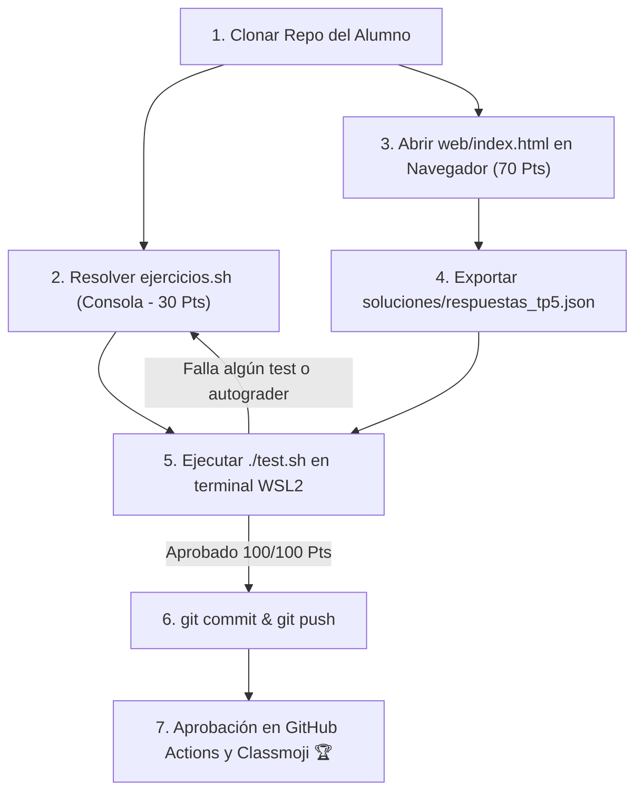

# Trabajo Práctico N° 5: Estructura de los Sistemas Distribuidos

> **Universidad Nacional de Jujuy (UNJu)**  
> **Facultad de Ingeniería — Departamento de Informática**  
> **Cátedra:** Sistemas Operativos II — Ciclo Lectivo 2026  
> **Equipo Docente:** Ing. María Fernanda Vázquez (Titular) | Ing. Fabio Damián Argañaraz Azua (JTP)  
> **Plataformas:** WSL2 (Ubuntu 24.04) | GitHub Classroom | Classmoji  
> **Modalidad:** Individual / Autoevaluativo con Autograding Criptográfico  
> **Estructura Pedagógica:** 30 Pts Práctica de Consola en Linux + 70 Pts Laboratorio Web Interactivo  

---

## 🎯 Objetivos de la Actividad

1. **Comprender la Arquitectura de los Sistemas Distribuidos:** Asimilar la definición fundamental de Tanenbaum (hardware autónomo vs software unificado como única computadora) y la diferenciación esencial entre Sistemas Operativos de Red (SOR) y Sistemas Operativos Distribuidos (SOD).
2. **Auditar Interfaces, Puertos y Enrutamiento en Linux (30 Pts):** Reconocer y aplicar las herramientas nativas del sistema operativo (`ip`, `ss`, `hostname`) para diagnosticar la conectividad y estado de red del nodo en la terminal.
3. **Modelar Topologías de Red y Métricas de Interconexión (Web - 70 Pts):** Calcular el número de enlaces físicos ($L$), el diámetro de red y evaluar el costo de instalación, costo de comunicación y tolerancia a fallos en redes completamente conectadas, en anillo y en estrella.
4. **Dominar el Ciclo de Vida de Llamadas RPC (Web - 70 Pts):** Comprender por qué la ausencia de memoria compartida exige la comunicación mediante paso de mensajes y el rol fundamental del empaquetado (marshaling) y desempaquetado (unmarshaling) en los Stubs mediante el simulador visual animado y Drag & Drop.
5. **Analizar la Comunicación en Grupo y Resiliencia (Web - 70 Pts):** Comparar grupos simétricos (compañeros/peer sin SPOF) frente a grupos jerárquicos (maestro-trabajador / coordinador-workers) evaluando el riesgo de Punto Único de Fallo (Single Point of Failure).
6. **Autoevaluación Local y en CI:** Probar la solución localmente con `./test.sh` y `autograder_tp5.py` (rúbrica con valores SHA-256 y salt de cátedra) antes de realizar `git push` a GitHub Classroom.

---

## 👨‍🏫 Demostración Docente vs. Tu Asignación

En la clase inaugural, el docente (Ing. Fabio Argañaraz) proyectó una sesión de Live-Coding con el repositorio **`TP05-demo`**.  
Para este trabajo práctico, debes **adaptar los principios explicados** a los requerimientos específicos de tu enunciado:

| Componente | Demostración en Clase (`TP05-demo`) | Lo que debes resolver en tu TP (`TP05`) |
| :--- | :--- | :--- |
| **Parte 1: Consola Linux (30 Pts)** | Diagnóstico del servidor docente con interfaces, gateway y sockets escuchando (`ss -tuln`). | Diagnóstico del nodo estudiante con interfaz activa, IP, gateway, tabla de enrutamiento y sockets en `soluciones/diagnostico_red_nodo.txt`. |
| **Parte 2: Módulo Web (70 Pts)** | Módulo web resuelto con autograder de demostración (`autograder_tp5_demo.py`). | Completar el laboratorio web interactivo (`web/index.html`), descargar `respuestas_tp5.json`, moverlo a `soluciones/` y verificar con `autograder_tp5.py`. |

---

## 📂 Estructura del Repositorio

```text
TP05/
├── .github/
│   └── workflows/
│       └── classroom.yml          # Workflow de evaluación automática en CI (GitHub Actions)
├── soluciones/
│   ├── .gitkeep
│   └── respuestas_tp5.json.template # Plantilla de referencia para la entrega web
├── web/                           # Módulo Web Interactivo (Simulador RPC, Topologías, Drag & Drop)
│   ├── index.html                 # Aplicación web interactiva para navegador
│   ├── styles.css                 # Estilos modo oscuro con Glassmorphism
│   └── app.js                     # Motor de eventos, Drag & Drop y exportador JSON
├── ejercicios.sh                  # Plantilla con el ejercicio de consola en Linux (TODOs - 30 Pts)
├── test.sh                        # Suite de pruebas automatizadas (/100 Pts)
├── autograder_tp5.py              # Evaluador en Python 3 con clave criptográfica (70 Pts)
├── rubric_tp5.json                # Rúbrica pública con hashes SHA-256 y salt
├── CHEATSHEET.md                  # Guía rápida de comandos de red y sistemas distribuidos
├── .gitattributes                 # Normalización de saltos de línea LF (Unix)
├── .gitignore                     # Exclusiones de archivos temporales y claves master
└── README.md                      # Enunciado y guía paso a paso
```

> **Nota de distribución:** `rubric_tp5_master.json` y `soluciones/respuestas_tp5.json` son materiales privados o generados por cada estudiante. No deben formar parte del repositorio distribuido. El primero está excluido mediante `.gitignore` y el segundo se genera al completar la actividad web.

---

## 🚀 Guía Metodológica Paso a Paso: Comandos, Salidas y Explicación Pedagógica



---

### 💻 Parte 1: Práctica de Consola en Linux (`ejercicios.sh` - 30 Pts)

Ejecute los siguientes comandos en su terminal de **Ubuntu (WSL2)**, observe la salida y comprenda el significado técnico antes de plasmar la solución en [`ejercicios.sh`](./ejercicios.sh):

#### 🔹 Ejercicio 1: Diagnóstico de Red, Interfaces y Enrutamiento en Linux (30 Pts)

* **Propósito Pedagógico:** En un sistema distribuido los procesadores son autónomos e independientes. Para comunicarse necesitan resolver nombres en dos capas: identificar el **host físico** (dirección IP) e identificar el **proceso destino** (puerto/socket).

1. **Obtener el nombre del nodo (`hostname`):**
   ```bash
   hostname
   ```
   * **Qué muestra:** El nombre de máquina local asignado al sistema.
   * **Explicación:** Identifica lógicamente al nodo dentro del grupo o clúster de procesamiento.

2. **Auditar la interfaz de Loopback (`lo`):**
   ```bash
   ip -4 addr show dev lo | awk '/inet /{print $2}' | head -n 1 | cut -d/ -f1
   ```
   * **Qué muestra:** `127.0.0.1`
   * **Explicación:** Interfaz virtual del kernel para comunicación IPC interna entre procesos locales sin salir al medio físico.

3. **Auditar interfaces de red activas e IP local (`ip addr`):**
   ```bash
   ip route show default | awk '{print $5}'
   hostname -I | awk '{print $1}'
   ```
   * **Qué muestra:** Nombre de interfaz (ej. `eth0`) y dirección IPv4 en la subred.
   * **Explicación:** Interfaz conectada a la red por la cual viajarán los paquetes hacia otros procesadores.

4. **Verificar el Gateway por defecto y la tabla de rutas (`ip route`):**
   ```bash
   ip route show default | awk '{print $3}'
   ip route show
   ```
   * **Qué muestra:** Dirección IP de la puerta de enlace predeterminada y el mapa de enrutamiento del kernel.
   * **Explicación:** Indica a qué dirección enviar todo paquete cuyo destino no pertenezca a la subred local.

5. **Inspeccionar sockets en modo LISTEN (`ss -tuln`):**
   ```bash
   ss -tuln
   ```
   * **Qué muestra:** Puertos TCP y UDP en los que existen procesos a la espera de peticiones entrantes.
   * **Explicación:** En sistemas distribuidos, un cliente se comunica con un servicio especificando `<IP_Servidor>:<Puerto_Socket>`.

6. **Generación del Archivo de Solución:**
   Al implementar la función `ejercicio1_diagnostico_red()` en `ejercicios.sh`, esta debe generar el archivo `soluciones/diagnostico_red_nodo.txt` con la estructura requerida.

---

### 🌐 Parte 2: Laboratorio Web Interactivo (`web/index.html` - 70 Pts)

Abra el archivo `web/index.html` en su navegador web favorito para interactuar con los simuladores visuales y autoevaluación:

1. **Topologías de Red y Métricas de Interconexión:**
   - Análisis comparativo de enlaces y diámetro para clústeres distribuidos.
   - Justificación de costo de instalación, costo de comunicación y tolerancia a fallos.
2. **Simulador Visual de Llamada RPC:**
   - Animación interactiva SVG del ciclo de vida de RPC.
   - Drag & Drop para ordenar secuencialmente las etapas: Cliente $\rightarrow$ Client Stub (Marshaling) $\rightarrow$ Canal TCP/IP $\rightarrow$ Server Stub (Unmarshaling) $\rightarrow$ Servidor.
3. **Modelos de Comunicación en Grupo:**
   - Clasificación de Grupo Compañero (simétrico, sin SPOF) vs Grupo Jerárquico (coordinador centralizado).
4. **Autoevaluación de Conceptos Teóricos:**
   - Switches segmentados y selección estructurada (sin negritas delatoras) sobre transparencia, sincronización y sistemas operativos distribuidos.
5. **Descarga y Entrega:**
   - Al completar el 100% de los ítems académicos, ingrese su Nombre, Legajo y GitHub para habilitar el botón **"Descargar respuestas_tp5.json"**.
   - Mueva el archivo descargado al directorio `soluciones/`:
     ```bash
     mv ~/Downloads/respuestas_tp5.json soluciones/
     ```

---

### 🧪 Parte 3: Validación Local con `test.sh` (100/100 Pts)

1. **Ejecutar la suite de pruebas local:**
   ```bash
   chmod +x test.sh ejercicios.sh
   ./test.sh
   ```
   * **Al clonar el repositorio:** Obtendrá `0 / 100 Pts` con diagnósticos claros de los componentes pendientes.
   * **Al completar Parte 1 (Consola):** Sumará `+30 Pts`.
   * **Al completar Parte 2 (Web):** Sumará `+70 Pts`.
   * **Puntaje total esperado para entrega:** `100 / 100 Pts (100%)`.

2. **Auditoría Criptográfica detallada del Módulo Web:**
   ```bash
   python3 autograder_tp5.py soluciones/respuestas_tp5.json
   ```

3. **Subir los cambios a GitHub Classroom:**
   ```bash
   git add ejercicios.sh soluciones/
   git commit -m "feat: resolucion completa TP05 (Consola 30 Pts + Web 70 Pts)"
   git push origin main
   ```

---

## 📚 Bibliografía Oficial Recomendada

* **Silberschatz, Galvin & Gagne:** *Fundamentos de Sistemas Operativos* (7ma Ed.) — Capítulo 16 (*Estructuras de Sistemas Distribuidos*).
* **Andrew S. Tanenbaum:** *Sistemas Operativos Distribuidos* — Capítulos 1 (*Introducción*) y 2 (*Comunicación en Sistemas Distribuidos / RPC*).
* **Diapositivas de Cátedra (Ing. María Fernanda Vázquez):** Unidad 5 (*Estructura de los Sistemas Distribuidos*).
