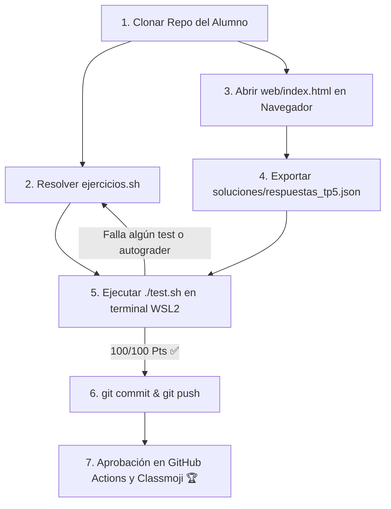

# Trabajo Práctico N° 5: Estructura de los Sistemas Distribuidos

> **Universidad Nacional de Jujuy (UNJu)**  
> **Facultad de Ingeniería — Departamento de Informática**  
> **Cátedra:** Sistemas Operativos II — Ciclo Lectivo 2026  
> **Equipo Docente:** Ing. María Fernanda Vázquez (Titular) | Ing. Fabio Damián Argañaraz Azua (JTP)  
> **Plataformas:** WSL2 (Ubuntu 24.04) | GitHub Classroom | Classmoji  
> **Modalidad:** Individual / Autoevaluativo con Autograding Criptográfico  

---

## 🎯 Objetivos de la Actividad

1. **Comprender la Arquitectura de los Sistemas Distribuidos:** Asimilar la definición fundamental de Tanenbaum (hardware autónomo vs software unificado como única computadora) y la diferenciación esencial entre Sistemas Operativos de Red (SOR) y Sistemas Operativos Distribuidos (SOD).
2. **Auditar Interfaces, Puertos y Enrutamiento en Linux:** Reconocer las herramientas nativas del sistema operativo (`ip`, `ss`, `route`, `/etc/hosts`) para resolver identidades de nodos y sockets en la red.
3. **Modelar Topologías de Red y Métricas de Interconexión:** Calcular el número de enlaces físicos ($L$), el diámetro de red y evaluar el costo de instalación, costo de comunicación y tolerancia a fallos en redes completamente conectadas, en anillo y en estrella.
4. **Dominar el Ciclo de Vida de Llamadas RPC (Remote Procedure Call):** Comprender por qué la ausencia de memoria compartida exige la comunicación mediante paso de mensajes y el rol fundamental del empaquetado (marshaling) y desempaquetado (unmarshaling) en los Stubs de cliente y servidor.
5. **Analizar la Comunicación en Grupo y el Balanceo de Carga:** Identificar las características de grupos abiertos vs cerrados y comparar grupos simétricos (compañeros/peer) frente a grupos jerárquicos (maestro-trabajador / coordinador-workers) evaluando el riesgo de Punto Único de Fallo (SPOF).
6. **Autoevaluación Criptográfica Local y en CI:** Probar la solución localmente con `./test.sh` y `autograder_tp5.py` (con rúbrica protegida SHA-256) antes de realizar `git push` a GitHub Classroom.

---

## 👨‍🏫 Demostración Docente vs. Tu Asignación

En la clase inaugural, el docente (Ing. Fabio Argañaraz) proyectó una sesión de Live-Coding con el repositorio **`TP05-demo`**.  
Para este trabajo práctico, debes **adaptar los principios explicados** a los requerimientos específicos de tu enunciado:

| Componente | Demostración en Clase (`TP05-demo`) | Lo que debes resolver en tu TP (`TP05`) |
| :--- | :--- | :--- |
| **Ejercicio 1** | Diagnóstico de red del servidor docente, socket bindings y rutas en `soluciones_demo/diagnostico_servidor_red.txt`. | Diagnóstico de interfaz activa, IP, gateway, resolución en `/etc/hosts` y teoría de nombrado en `soluciones/diagnostico_red_nodo.txt`. |
| **Ejercicio 2** | Modelado de topologías de red para un clúster docente de $N=8$ nodos ($L_{comp}=28, L_{anillo}=8, L_{est}=7$). | Modelado de topologías para un clúster de $N=6$ nodos ($L_{comp}=15, L_{anillo}=6, L_{est}=5$) en `soluciones/analisis_topologias.txt`. |
| **Ejercicio 3** | Simulación RPC de función de hash token en `soluciones_demo/simulacion_rpc_demo.txt`. | Simulación RPC de función de suma (`CALC_SUM:45:55 -> 100`) y fundamentación de mensajes en `soluciones/simulacion_rpc.txt`. |
| **Ejercicio 4** | Simulación de Grupo Compañero (Peer) simétrico de 4 nodos sin SPOF en `soluciones_demo/grupo_companero_demo.txt`. | Simulación de Grupo Jerárquico con coordinador repartiendo 6 jobs a 3 workers (Round-Robin) y análisis de SPOF en `soluciones/balanceo_grupo.txt`. |
| **Ejercicio 5** | Módulo web evaluado con `autograder_tp5_demo.py` y `rubric_tp5_demo.json`. | Módulo web evaluado con `autograder_tp5.py` y `rubric_tp5.json` (hashes SHA-256 + salt de cátedra). |

---

## 📂 Estructura del Repositorio

```text
TP05/
├── .github/
│   └── workflows/
│       └── classroom.yml          # Workflow de evaluación automática en CI (GitHub Actions)
├── soluciones/
│   ├── .gitkeep
│   └── respuestas_tp5.json.template # Plantilla de referencia para la entrega web
├── web/                           # Módulo Web Interactivo (Simulador RPC, Topologías, Drag & Drop)
│   ├── index.html                 # Aplicación web interactiva para navegador
│   ├── styles.css                 # Estilos modo oscuro con Glassmorphism
│   └── app.js                     # Motor de eventos, Drag & Drop y exportador JSON
├── ejercicios.sh                  # Plantilla con las funciones prácticas de consola en Linux (TODOs)
├── test.sh                        # Suite de pruebas automatizadas (/100 Pts)
├── autograder_tp5.py              # Evaluador en Python 3 con clave criptográfica
├── rubric_tp5.json                # Rúbrica pública protegida con hashes SHA-256
├── CHEATSHEET.md                  # Guía rápida de comandos de red y sistemas distribuidos
├── .gitattributes                 # Normalización de saltos de línea LF (Unix)
├── .gitignore                     # Exclusiones de archivos temporales y claves master
└── README.md                      # Enunciado y guía paso a paso
```

---

## 🚀 Flujo de Trabajo Paso a Paso



### Paso 1: Resolver la Práctica de Consola en `ejercicios.sh`
Abra el proyecto en su editor (VS Code en WSL2) y complete el código dentro de cada función en [`ejercicios.sh`](./ejercicios.sh):
* **Ejercicio 1 (20 Pts):** Diagnóstico de interfaces (`ip addr`, `ip route`), puerta de enlace, verificación de `/etc/hosts` y fundamentación de nombrado hacia `soluciones/diagnostico_red_nodo.txt`.
* **Ejercicio 2 (20 Pts):** Modelado de topologías de red para $N=6$ nodos (enlaces completos: 15, anillo: 6, estrella: 5) y evaluación de costos y SPOF en `soluciones/analisis_topologias.txt`.
* **Ejercicio 3 (20 Pts):** Simulación del ciclo RPC para `CALC_SUM:45:55` (marshaling, red, unmarshaling, resultado 100) y justificación teórica de mensajes en `soluciones/simulacion_rpc.txt`.
* **Ejercicio 4 (20 Pts):** Coordinador de Grupo Jerárquico distribuyendo 6 tareas entre 3 trabajadores (Round-Robin) y discusión del SPOF en `soluciones/balanceo_grupo.txt`.

### Paso 2: Resolver la Teoría y Simulador en `web/index.html`
1. Abra [`web/index.html`](./web/index.html) en su navegador web preferido.
2. Complete sus datos personales (Nombre, Legajo y GitHub).
3. Responda las 5 preguntas conceptuales de Sistemas Distribuidos (sin negritas delatoras).
4. Complete los 6 switches binarios de clasificación (SOR vs SOD, Abierto vs Cerrado, etc.).
5. Interactúe con el **Simulador Visual de Invocación RPC** y configure los parámetros teóricos.
6. Ordene secuencialmente las 6 etapas de la **Llamada RPC** en el tablero Drag & Drop.
7. Configure las propiedades de principios de diseño y tolerancia a fallos.
8. Haga clic en **`📥 Descargar respuestas_tp5.json`** y guarde el archivo en la carpeta `soluciones/` de este repositorio.

### Paso 3: Ejecutar la Suite de Pruebas Local
En su terminal de **Ubuntu (WSL2)** o Linux nativo, otorgue permisos y ejecute:
```bash
chmod +x test.sh ejercicios.sh
./test.sh
```

Alcanzados los **100 / 100 Puntos**, proceda a enviar su entrega:
```bash
git add .
git commit -m "Entrega Trabajo Practico 5 - Sistemas Distribuidos"
git push origin main
```
